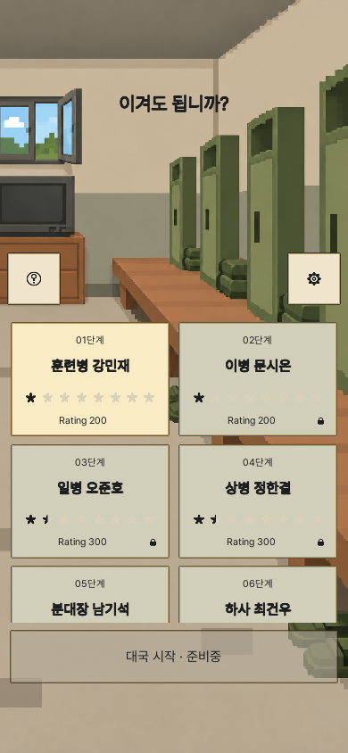
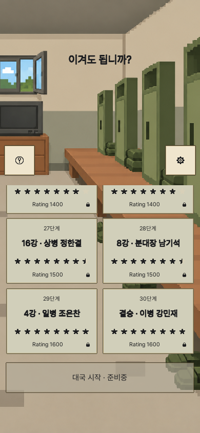

# 로비 스테이지 목록 축소 — 2026-10-16

## 적용

- 2열 카드 크기와 목록 아래쪽 위치를 유지하고, 위쪽을 내려 2줄과 세 번째 줄의 절반을 표시한다. 1080 기준 최대 높이는 933(378×2 + 354÷2)이다.
- 도움말·설정 버튼과 상태 안내는 목록 위쪽을 따라 내려간다. 제목과 하단 대국 시작 버튼은 기존 위치다.
- 짧은 화면은 기존 상단 여백 안에서 목록 높이를 더 줄이고 세로 스크롤을 유지한다.
- `Lobby.prefab`에 `RankLobbyFitter`와 기존 요소 참조를 저장했다. `RankAppRoot`는 중첩 프리팹 변경을 그대로 상속하며 추가 변경이 없다. 런타임 UI 오브젝트를 생성하지 않는다.
- 재적용: Unity 메뉴 `StageGame/Apply Compact Lobby`. 전체 UI 생성 경로에도 같은 설정을 사용한다.

## 검증

- Unity 6000.3.15f1 실제 적용 성공: `unity-apply.log`.
- 최종 EditMode **3/3 통과**: `unity-tests.xml`, `unity-tests.log`.
- 한영 × 8개 웹 캔버스 크기의 목록 처음/끝·대국 위/아래와 별도 1080/호스트 회귀 검사, 총 **80장** 캡처.
- 정상 세로 화면은 세 번째 줄의 중앙이 목록 하단과 일치한다. 첫 카드·도움말·설정 입력과 마지막 카드 접근을 검사했다. 전체 검사 최소 터치는 약 44px, 로비 최소는 48.89px다.
- 390×844 목록 높이 336.92px. 짧은 320×390에서는 134px로 줄어든다. `screens/layout-metrics.json` 참조.
- 첫 자동 검사 통과 후 시각 검토에서 390×844 스크롤 끝 캡처의 마스크 갱신 지연을 발견했다. RectTransform 크기 변경 즉시 배치하도록 보완하고 같은 검사를 재실행했다. 첫 결과는 `first-pass/`, 최종 결과는 `screens/`에 구분한다.
- 이번 변경은 **소스·저장 프리팹·Unity 검증 완료**다. 새 WebGL 빌드·공개 배포·실기기 검사는 실행하지 않았다.

