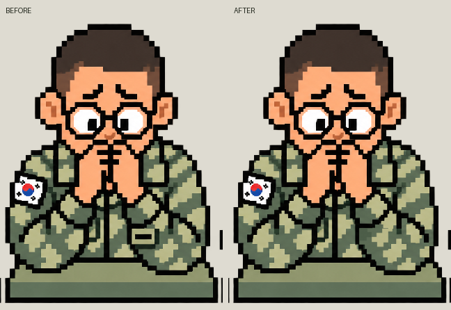

# 문시온 계급장 가림 수정

2026-10-18 KST. Unity 적용·검증·WebGL 빌드와 로컬 브라우저 확인 완료. 사용자 푸시 후 Pages `b0e2901`의 Actions 성공과 공개 파일 23/23 해시 일치를 확인했다. 직전 멀티 UI 개편 `85a114e`도 포함한다. 공개 사이트에서 친선전 종료·리매치 요청·상대 퇴장 화면을 확인했다. 문시온은 기존 로컬 실제 착수 화면의 시각 검증과 공개 빌드 파일 일치로 반영을 확인했으며, 이번 공개 브라우저에서 2단계 인물 화면을 별도로 재현한 것은 아니다.

## 변경

- 문시온 C02의 생각하는 자세에서 왼쪽 가슴 계급장이 앞팔 위에 그려져 있었다. 계급장과 테두리·그림자를 소매 위장 무늬로 복원해 가슴의 계급장이 팔 뒤에 가려지게 했다.
- 기존 v6 원본을 보존하고 `C02-occlusion-v7.png`를 새로 저장했다. `portrait-import.json`과 저장된 RankTheme의 세 스프라이트 참조를 교체했다.
- 실제 수정은 1536×1024 원본 중 67×51 범위의 3,231픽셀이다. 얼굴·머리·손·다른 표정과 전체 알파 채널은 동일하다. 첫/셋째 셀은 픽셀 단위로 완전히 동일하다.
- 기존 19명과 결승 복장, 총20개 아틀라스·60개 자세를 접촉 시트로 점검했다. 계급장/견장의 팔·손 가림 기준에서 이번 수정 외 추가로 확정한 오류는 없었다. 정한결 C04의 생각하는 자세는 계급장 오른쪽을 팔 경계가 가리는 상태라 유지했다.

## 검증

- `pixel-diff.json`: 수정 범위, SHA256, 알파·나머지 두 상태 동일 확인.
- `selected-portrait-audit.json`, `audit-0.png`~`audit-4.png`: 선택된20개 원본/런타임/임포트 해시 일치와60상태 점검 기록.
- `unity-tests.xml`: Unity2/2 통과. 전체30단계의 상태별 캐릭터 참조·모든 인물의 Point 필터/밉맵 비활성/무압축을 검증했다. 문시온2단계와25단계(64강)의 세 자세를1080×1920·390×844에서 캡처해12개 화면을 저장했다.
- `browser-thinking.png`: 새 빌드를 `http://127.0.0.1:8080/`에서 실행하고2단계에 입장해 실제 착수 직후의 생각하는 자세를 확인했다. 테스트를 위한 게임 내부 상태 주입은 하지 않았다.
- `build-WebGL.txt`: 성공, 오류0·경고0,91,662,728바이트. 실제 기기·Android 빌드는 이번 범위에 포함하지 않았다.
- `published-files.json`: 웹 빌드23파일과 Pages 작업 폴더 복사본 SHA256 대조. `source-files.json`: 빌드 당시 Unity 소스/설정/Excel 해시. `deployment-commit.txt`: 사용자 푸시용 커밋.

## 재현과 출처

`Client/Tools/CorrectPortraitOcclusion.py`는 이전 v6 해시를 검사한 뒤 작은 소매 영역만 수정한다. 팔의 기존 계단형 검은 윤곽과 투명도를 유지하며 인접 군복의 색상 질감을 사용한다. 사용자 승인에 따른 직접 픽셀 수정이며 새 외부 사진/이미지 자산은 반입하지 않았다. 원본 생성 경로는 `Licence/CHARACTER-PIXEL-STYLE-20261015-V6.json`, 수정 출처는 `Licence/CHARACTER-OCCLUSION-20261018-V7.json`에 기록했다.

공개 확인: `public-deployment-verification.json`, [Pages 실행 39124421843](https://github.com/Hwanggok2/Permission-to-win/actions/runs/39124421843). 실제 공개 멀티 캡처는 `public-multiplayer-menu.png`, `public-multiplayer-result.png`, `public-multiplayer-rematch.png`, `public-multiplayer-opponent-left.png`다. 레이팅 미반영 친선전에서 양쪽 200점·변동 0을 확인했고 시험 방은 퇴장했다.
