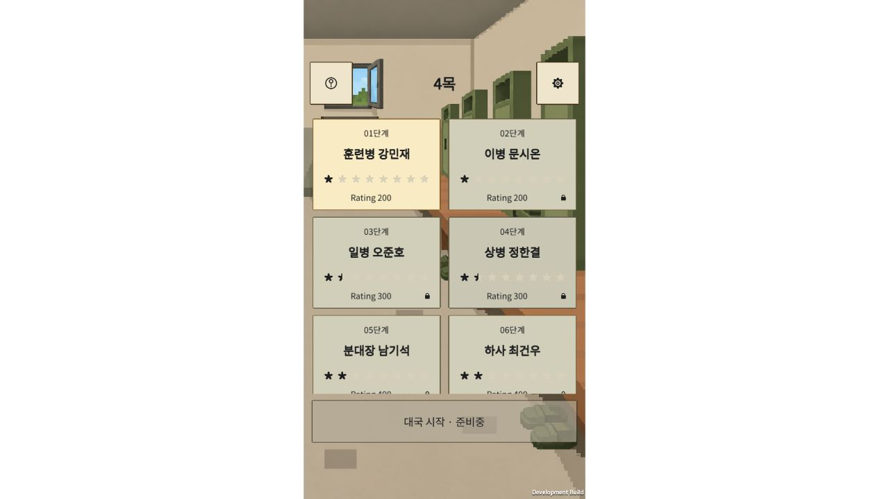
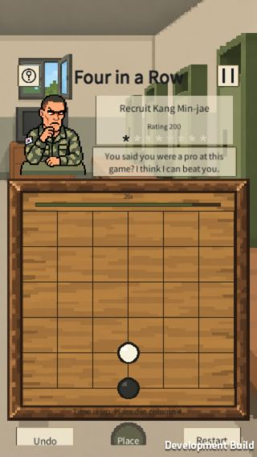
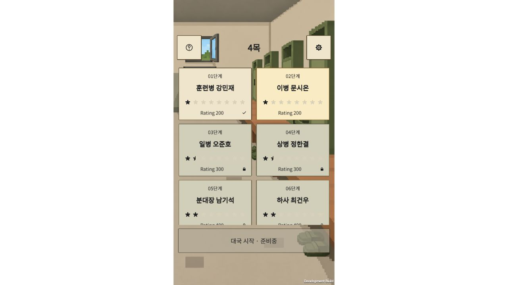

# PC 중앙 세로 화면·모바일 유지 재배포 — 2026-10-16

상태: **새 WebGL 빌드·로컬 브라우저 검증 완료. 사용자가 Pages 커밋을 푸시했고 Actions 성공, 공개 파일 18/18 해시 일치를 확인했다. 서버 세션의 공개 PC·모바일 화면·입력 독립 검사도 완료됐다.**

사용자가 서버 세션에서 PC는 중앙의 모바일 크기 세로 게임 영역과 좌우 여백을 사용하고, 모바일 화면도 확인한 뒤 재배포까지 마무리하도록 요청했다. 최초 안내·중앙 착수 안내·대국 도움말의 기존 미커밋 작업을 보존해 최종 소스에 함께 포함한다. 서버 세션의 `Server/` 변경은 이번 UI 통합·배포 커밋 범위에서 제외한다.

- 클라이언트 인계 기준: `Client/Evidence/desktop-centered-20261016/HANDOFF.md`, 검증 결과, 소스 동결, Unity 종료 확인.
- 진단: [가로 창 배치 오류](../../../../Server/Evidence/desktop-layout-diagnosis-20261016/README.md).
- 공개 주소: https://hwanggok2.github.io/StageGame/
- 소스: `022c09a32715d6c13ee8c1702377916eb9b1b2ce`. 앞선 `5fdb63a`에 첫 규칙 안내·대국 도움말·Excel 변경을 별도로 보존했다.
- 배포: `7cda6874e0cb6c1dacc1824d66195a9939a789ee`, [Pages Actions 성공](https://github.com/Hwanggok2/StageGame/actions/runs/38837758172). `public-deployment-verification.json`에 실제 응답·해시·버전·확인 시점을 기록했다.
- 새 빌드 완료: **2026-10-16 10:35:16 KST**, Unity 6000.3.15f1, WebGL 개발 빌드, 오류0·경고0. 배포 파일18개, 총88,621,572바이트. 빌드 보고서 크기와 웹 템플릿 포함 총파일 크기는 구분한다.
- 빌드 전후 Client 소스536개와 클라이언트 동결 목록571개의 해시 차이0. `build-verification.json`, `source-before-build.json`, `client-source-freeze.json`, `published-files.json` 참조.
- 원격 확인 당시 main은 `d77e122`로, 새 소스·관리 문서 커밋은 로컬에만 있다. Pages 공개 반영과 소스 main 업로드를 구분한다.
- 배포 워크트리: `C:/Users/JW/.codex/worktrees/github-pages/StageGame`, 브랜치 `codex/github-pages`.
- 배포 구조: 빌드 파일을 최상위에 둔다. `public/` 중간 폴더를 만들지 않는다. 게임 빌드와 `.nojekyll`, 최소 `.github/workflows/pages.yml`만 포함하고 소스·문서·검증 기록은 넣지 않는다. Actions 업로드 경로는 `.`이며 공식 업로드 액션은 `.git`·`.github`를 제외한다.
- 인증: 비대화형 Git 인증 확인이 실패해 정식 GCM 로그인 흐름을 열었으나, 사용자가 “수정본 내가 올렸다”고 알려왔다. 그 뒤 추가 인증 요구와 중복 푸시를 중단하고 원격 커밋·Actions·공개 파일을 읽어 검증했다. 임시 GCM 대기는 종료했다. 사용자의 업로드를 에이전트가 푸시한 것으로 기록하지 않는다.

## 화면 계약

PC는 최대480 CSS px의 게임 영역을 중앙에 두고 좌우는 흰 여백으로 남긴다. 가로 창은 높이×9/16에 맞추되 최소320px를 확보한다. 모바일 세로 폭320/390px는 그대로 사용한다. Unity에 실제 게임 canvas 크기와 해당 영역의 안전 여백을 함께 전달한다. 짧은 가로 화면에서는 세로 스크롤로 조작 버튼에 접근한다.

| 실제 브라우저 창 | 게임 canvas | 좌우 각각 여백 |
|---|---|---|
|1280×720|405×720|437.5px|
|1920×1080|480×1080|720px|
|800×1200|480×1200|160px|
|390×844|390×844|0|
|390×664|390×664|0|
|320×568|320×568|0|
|844×390|320×390|262px|

## 검증 구분

- 클라이언트 인계: Unity12/12·Node VM19/19, Unity100캡처. [클라이언트 인계](../../../../Client/Evidence/desktop-centered-20261016/HANDOFF.md). 최초 규칙 안내와 앱당1회 안내의 이전 회귀는 별도16/16·데이터46/46 기록이며 합산하지 않는다.
- 총괄 실제 로컬 브라우저: 새 빌드 전용 `127.0.0.1:8773`에서 위 크기의 DOM 좌표와 화면 확인. PC 로비의 첫/마지막 단계 스크롤, 첫 규칙 패널 닫기, 열 미리보기·놓기, AI 응수, 대국 도움말 재열기, 일시정지→나가기 확인→로비, 영어 전환과 음악 끄기의 새로고침 유지 확인.
- 모바일390×664 로비 및320×568 대국, 가로844×390에서 하단 버튼까지 스크롤하고 다시하기 확인창을 실제 입력으로 열었다.800×1200에서도 중앙 폭480px와 확인창을 확인했다. `browser-metrics.json`, `screens/` 참조. 검사 종료 시 브라우저 크기 원복.
- 해당 로컬 탭의 브라우저 warn/error 로그0. 실제 휴대폰 Safari·카카오톡·Android·Toss SDK, 사람 청취, 실광고/결제 검사와 구분한다. Toss 미리보기는 최종 공개 검사와 분리하며 여기서 통과로 기록하지 않는다.
- 영어 단계 상세의 한 줄 설명 끝부분 잘림을 관찰했다. 이번 중앙 배치 수정의 성공과 별개인 후속 문구/표시 점검 항목이다.
- `local-800x1200-lobby.jpg`는 크기 변경 직후 이전 프레임이 잡혀 시각 검증 근거에서 제외한다. 같은 크기의 유효 캡처는 `local-800x1200-match-confirm.jpg`다.

## 공개 브라우저 최종 검사

서버 세션이 공개 주소를 새로고침한 뒤 PC1280×720/1920×1080, 모바일390×844/320×568/390×664를 직접 검사했다. 위 표와 같은 중앙 정렬/모바일 전체 폭, 로비·설정·목록 스크롤·대국판·하단 버튼을 확인했다. 390×664에서 가운데 열 선택→놓기→돌 배치→일시정지→나가기 확인→로비까지 실제 입력으로 통과했다. 기존1단계 완료·2단계 해금과 한국어·효과음·음악 설정도 유지됐다. 오류/경고 로그0, 검사 viewport 원복.

원본은 `Server/Evidence/public-layout-20261016/`이며 검토한 화면9개·DOM/콘솔 기록을 이 폴더의 `public-browser/`에 원본 해시와 함께 보존했다. 서버 원본과 소스는 수정하거나 이번 커밋에 포함하지 않았다. 실제 휴대폰, D1/기기 간 동기화, 광고/결제 검증은 아니다.

