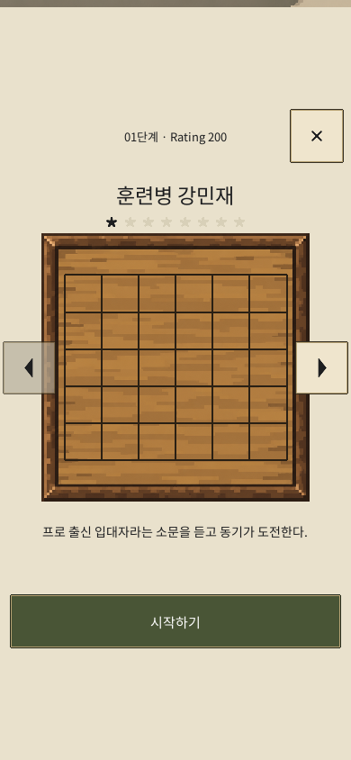

# 스테이지 상세 패널 중앙 배치 — 2026-10-16

사용자 제보: 상세 패널의 단계 번호·닫기 버튼·계급·판·시작하기가 화면 위쪽에 몰리고 아래에 큰 빈 공간이 남는다. 다른 화면처럼 중앙 쪽으로 옮기도록 요청했다. `user-before.png`는 사용자가 첨부한 수정 전 화면이며 편집하지 않았다.

상태: **소스·저장 프리팹 수정 및 Unity 검증 완료. 사용자 요청으로 소스 수정까지만 유지.** 현재 공개 Pages `7cda687`에는 이 변경이 포함되지 않았다.

적용 범위는 스테이지 상세 화면이다. 안전영역 안에서 패널 전체를 세로 중앙 배치하고, 작은 높이는 닫기·시작하기 접근과 기존 스크롤을 유지한다. 우측 슬라이드·좌우 스테이지 이동 이후에도 중앙 위치를 유지해야 한다. 로비·대국·원본 그래픽·게임 규칙·Excel 데이터는 보존한다.

`RankDetailFitter`가 저장된 헤더와 스크롤 영역의 상하 여백을 같게 맞춘다. 가로 슬라이드 루트의 Y는 그대로 두어 애니메이션 종료 시 위치가 초기화되는 충돌을 피했다. 영어 설명은 기존 글자 크기에서 두 줄이 들어가도록 영역 높이를 늘렸다. Detail 프리팹 변경은 RankAppRoot의 중첩 프리팹에 적용된다. UI 객체를 런타임에 만들지 않는다.

Unity 관련 검사 **7/7 통과**, 한영·6개 크기·일반/Toss 안전영역의24조합을 포함한58캡처를 확인했다. 상하 여백 차이는0.001px 미만, 최소 터치48.88px 이상. 작은 호스트 화면의 스크롤 끝 시작 버튼, 닫기, 좌우 단계 이동, 슬라이드 입력 잠금과 최초 실행1단계·자동 규칙 안내를 검사했다. 30개 한영 설명은 영역 안에 들어간다. 총괄은 한국어390×844 및 영어390×664 캡처와 수치를 직접 검토했다.

상세 증거: [클라이언트 인계](../../../../Client/Evidence/detail-centered-20261016/HANDOFF.md), [검사 결과](../../../../Client/Evidence/detail-centered-20261016/verification.json).

총괄이 WebGL 업데이트를 시도했으나 **자동 승인 검토가 실행 전에 거절했다.** 이유는 사용자의 “이번 웹 빌드는 내 승인 받고 해” 조건에 대해 이번 상세 패널 수정본의 별도 승인이 없다는 것이다. 빌드 프로세스는 시작되지 않았고 기존 공개 파일은 그대로다. 소스·프리팹·검사 자료를 먼저 보존한 뒤 해당 빌드 승인을 요청한다. 실제 브라우저·실기기·새 공개 반영 성공으로 기록하지 않는다.

최종 사용자 선택: **소스 수정까지만 유지**. 수정본은 `b4eff07`에 보존했고 WebGL 빌드·Pages 갱신·공개 배포를 진행하지 않는다. 앞선 승인 대기 단계는 이 선택으로 종료했다.
