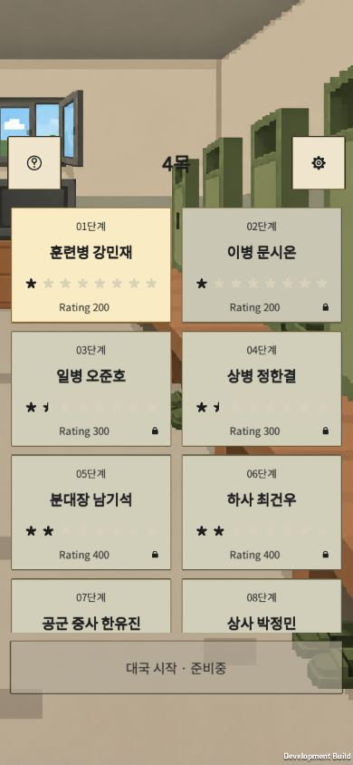

# 외부 친구 테스트 — 2026-10-16

[4목 플레이](https://shares-country-steel-fridge.trycloudflare.com/)

사용자가 클라이언트 수정 완료 후 웹 빌드와 외부 테스트 배포를 승인했다. 클라이언트의 최종 인계·Unity 종료를 확인하고, `Client/Evidence/rating-curve-20261016/source-freeze.json`의 524개 파일 해시가 모두 일치하는 상태에서 빌드했다. 다른 역할 세션은 재가동하지 않았다.

| 항목 | 결과 |
| --- | --- |
| 빌드 | Unity 6000.3.15f1 WebGL 개발판, 2026-10-16 00:55 KST 완료, 오류 0·경고 0 |
| 반영 | 최신 Rating 200~1600 AI 곡선, 군대 도트 배경·캐릭터·목재판, 턴 타이머, Easy Lemon·설정·라이선스 |
| 원본 검증 | 클라이언트 최종 Unity 44/44·데이터 46/46 결과를 인계받음. 총괄의 재실행 결과와 구분 |
| 배포 | WebGL 18파일만 별도 복사, SHA256은 `published-files.json`. 저장소·문서·비밀 파일은 공개하지 않음 |
| 전송 | `.wasm`과 `.data` gzip 응답 확인. 주요 게임 파일 압축 합계 약 60MB |
| 서버 검사 | `Tools/test_serve_playtest.py` 1/1 통과. gzip 내용 일치, WASM MIME, 경로 이탈·숨김·소스 파일 차단 |
| 실제 브라우저 | 공개 HTTPS에서 로딩·첫 대국/AI 진행, 390×844 화면, 일시정지→나가기 확인→로비, BGM 켜짐→꺼짐→켜짐 UI 확인 |
| 콘솔 | 확인 시 페이지 error/warn 로그 없음 |
| 미검증 | 실제 휴대폰·토스 호스트, 친구의 체감 난이도/재미, 음악 실제 청취·루프 경계, 실광고·실결제 |

설정 증거: [음악 꺼짐](settings-music-off.png), [켜짐 복원](settings-music-on.png). 화면 크기 재설정 후 테스트 탭은 열어 두었다. 자동 시간 초과 착수도 진행됐으므로 이번 짧은 실행을 사람의 정상 대국 성적이나 난이도 평가로 사용하지 않는다.

## 운영

Cloudflare Quick Tunnel을 이용한 임시 URL이다. 이 PC의 인터넷·전원 및 서버/터널 프로세스가 유지되어야 한다. 절전·종료 시 끊기며 터널 재시작 시 주소가 바뀔 수 있다. 로그인 제한 없는 주소이므로 링크를 가진 사람은 접속할 수 있다. [공식 안내](https://developers.cloudflare.com/tunnel/get-started/quick-tunnels/) 확인일 2026-10-16.

- 공개 폴더: `.work/playtest-20261016/public` (빌드 복사본, Git 제외)
- 서버: `Docs/Management/Tools/serve_playtest.py`, `127.0.0.1:8772`에만 바인딩
- gzip 캐시: `.work/playtest-20261016/gzip` (공개 폴더 밖)
- 현재 프로세스·실행 인자·로그: `.work/playtest-20261016/`의 `server-process.json`, `tunnel-process.json`, 로그 파일
- 종료 시 위 기록과 실제 프로세스 명령줄이 일치하는지 확인한 뒤 이 테스트의 두 프로세스만 종료한다. 오래된 PID를 그대로 사용하지 않는다.
- 서버는 게임 파일의 GET/HEAD만 제공한다. 방문자 주소·URL을 자체 로그로 남기지 않는다. 거래 서버·과금 설정은 변경하지 않았다.

현재 개발 빌드를 공유한 것이며 원스토어/앱인토스 공개 출시 또는 상용 SDK 검증 완료를 뜻하지 않는다. 빌드·도구 실행 파일은 커밋/푸시하지 않았다.
