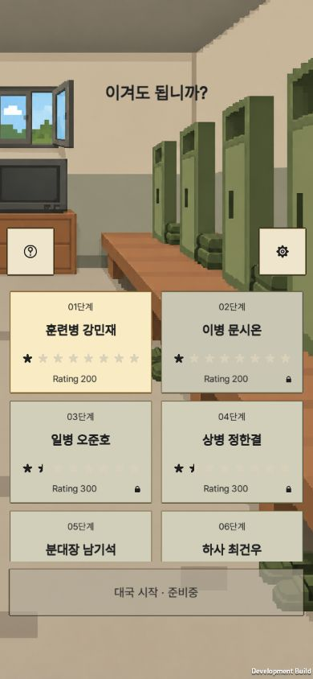
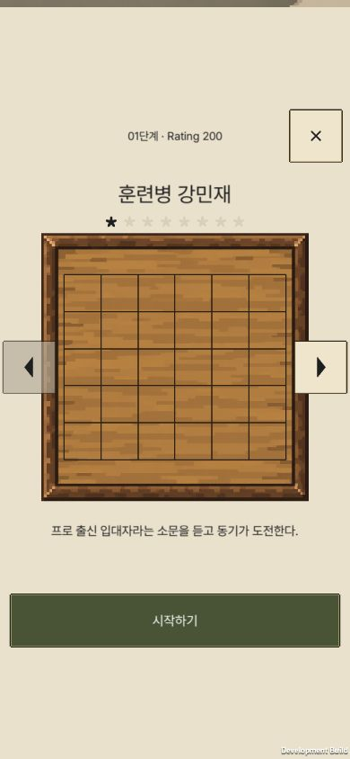
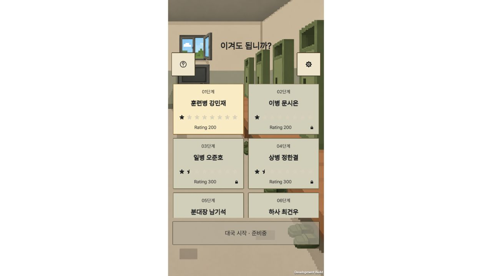

# 최신 WebGL 빌드·로컬 커밋 — 2026-10-16

사용자 요청: “웹 빌드하고 커밋하자 배포는 내가 할게”. **빌드·커밋 완료, 푸시·배포 미실행.**

- 소스 커밋: `ddf43b0` — 제목·Pretendard·로비 목록 개선과 Rating 400~600 기본 방어 보강, Excel/라이선스/검증 기록. 이전 상세 패널 중앙 배치 수정도 포함한다.
- Pages 커밋: `d6bc14b` (`codex/github-pages`). 워크트리 `C:/Users/JW/.codex/worktrees/github-pages/StageGame`.
- Unity 6000.3.15f1 WebGL 개발 빌드, 17:24 KST 완료. 오류 0·경고 0, 55.84초. [빌드 보고서](build-report.txt).
- 빌드 입력 561개가 전후 동일. Excel exporter 일치와 데이터 46/46을 이번 작업에서 재확인했다. 생성 JSON과 Resources 사본, 라이선스 원문 포함 여부가 일치한다. [입력·산출물 검사](build-verification.json).
- 결과물 23개, 총 91,556,025바이트. Pages 루트의 `index.html`과 나머지 빌드 파일이 Git 커밋에서도 SHA-256 일치. 기존 `.nojekyll`과 Actions 설정만 추가로 유지한다. `public/` 폴더·소스·문서는 넣지 않았다. [파일 목록](build-files.json), [커밋 검증](pages-verification.json).
- localhost의 `/Permission-to-win/` 경로에서 실제 브라우저 확인: 첫 규칙 안내, 열 선택·놓기·AI 응수, 일시정지·나가기 확인, 390×844 로비 2.5줄과 상세 중앙 배치, 1280×720 중앙 405px 게임 영역. 경고·오류 로그 0. [브라우저 기록](local-browser.json).
- 기존 Unity 검사(로비 3/3, 글꼴 12/12, 제목 11/11, AI 37/37)는 각 기능 담당의 저장된 실행 증거이며 이번에 모두 재실행했다고 기록하지 않는다. 실제 휴대폰·Toss 앱·공개 배포 검사는 이번 범위에 포함하지 않는다.

사용자가 위 Pages 워크트리에서 `codex/github-pages`를 푸시하면 기존 Actions가 배포한다. 소스 `main` 커밋은 별도로 보존한다. 서버 개발 변경은 이번 커밋에서 제외했다.

